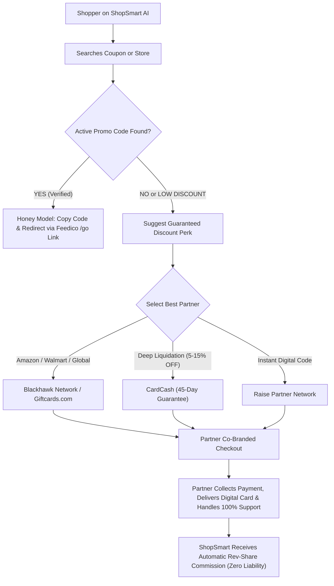

# ShopSmart AI — Master Partnership Strategy Blueprint & Future Approvals Roadmap
**File:** `STRATEGY_BLUEPRINT_PARTNERSHIP.md` (Project Root)  
**Status:** ACTIVE FUTURE APPROVALS LEDGER & SINGLE SOURCE OF TRUTH  
**Last Updated:** 2026-11-04  
**Architecture Principle:** Two-Phase Phased Rollout (Phase 1 Lean Launch $\rightarrow$ Phase 2 B2B Wholesale Expansion), 100% Zero-Liability, Zero-Headache, Hands-Off Fulfillment, No Minimum Commitment.

---

## 1. Executive Summary: The Two-Phase Operating Strategy

To protect the business legally, avoid early regulatory friction, build verified domain authority, and scale without administrative overwhelm, ShopSmart AI operates on a **Strict Two-Phase Phased Rollout**:

```
┌────────────────────────────────────────────────────────────────────────────────────────┐
│                        SHOPSMART TWO-PHASE ARCHITECTURE ROADMAP                        │
├───────────────────────────────────────────┬────────────────────────────────────────────┤
│ PHASE 1: DAY-1 LAUNCH & TRUST (DAYS 1-40) │ PHASE 2: WHOLESALE TRAVEL (DAY 40 ONWARD)  │
├───────────────────────────────────────────┼────────────────────────────────────────────┤
│ • Zero Legal Friction, 100% Compliant     │ • High-Leverage B2B Wholesale Fares        │
│ • Shopping Search & Price Comparison      │ • Closed User Group (CUG) Free Club Pass   │
│ • Hardware AI TrustSheet (Bright Data)    │ • Flights: Duffel NDC Net Fares            │
│ • Virtual Try-On (VTON Cloth Studio)      │ • Hotels: Agoda B2B / Hotelbeds Net Rates  │
│ • Coupons: Feedico Managed Catalog (Global│ • Buses: Distribusion / Omio B2B Net Rates │
│ • Pharmacy: Apollo 24|7 & Tata 1mg (IN)   │ • Events: Ticket Evolution Live Tickets    │
│ • Rx Discounts: GoodRx API (US ZIP/Card)  │ • Guaranteed Cards: Blackhawk/CardCash/Rais│
│ • Supplements: iHerb (180+ Countries)     │ • Webhook + Proactive Deflection Email     │
│ • Software & SaaS Savings Terminal (NEW): │                                            │
│   - Tier 1 (Startups): Secret Credits     │                                            │
│   - Tier 2 (Existing Users): NachoNacho   │                                            │
│     + In-House Verified Billing Codes     │                                            │
│ • Travel/OTT: Kept in Discovery Mode      │                                            │
└───────────────────────────────────────────┴────────────────────────────────────────────┘
```

---

## 2. Phase 1: Core Launch Architecture & Immediate Onboarding Partners

In Phase 1, our primary objective is to launch the live domain, capture massive zero-cost organic search traffic (e.g. buyers actively searching for Canva Pro promo codes, Shopify deals, electronics discounts), establish verified user trust, and generate clean revenue without middleman networks (zero Cuelinks/EarnKaro).

### 2.1. Phase 1 Partner Matrix (Immediate Onboarding)

| Vertical / Category | Primary Partner Platform | Network / Approval Channel | Model & User Value | ShopSmart Priority & Revenue |
| :--- | :--- | :--- | :--- | :--- |
| **Retail & E-commerce Coupons** | **Feedico Managed Catalog** (`api.feedico.io`) | Direct Partner (`fdco_` token) | Verified Honey-style promo codes for 48,000+ brands across 6 countries (IN, US, UK, CA, AU, AE) | 65% Revenue Share |
| **Software Credits (Tier 1: Startups / New Accounts)** | **Secret B2B Partner Program** (`joinsecret.com`) | Free Community Partner Application ($0 cost) | $1,000–$10,000+ free cloud & SaaS credits for AWS, Stripe, HubSpot, Notion, Miro | $0 Upfront; Direct User Benefit (Primary) + Rev-Share |
| **SaaS Subscriptions (Tier 2: Existing Active Users)** | **NachoNacho Partner API + In-House Verified Vault** (`nachonacho.com`) | Free Community Perks Partner + In-House Verified Billing Code Registry | Guaranteed 15%–30% instant billing reduction on Canva Pro, Zoom, Shopify, Hostinger, Adobe, NordVPN via Annual Switch & Billing Settings promo codes | **User Savings 1st Priority**; Zero-Liability, Zero-Fintech Hassle |
| **Prescription Medicines (India)** | **Apollo 24|7 & Tata 1mg Direct** | Impact.com / Direct Partner Portal | **Exact prescribed branded medicine** at Flat 15%–18% off MRP (auto-applied code `SHOPSMART18`) | 3%–5% Order Commission |
| **Prescription Discounts (US)** | **GoodRx Direct Partner API** | GoodRx Partner Portal / Impact.com | Medicine + ZIP Code lookup $\rightarrow$ Local CVS, Walgreens, Walmart comparison + Digital Rx card (20%–80% off) | Pay-Per-Claim ($2.50–$6.00/claim) |
| **Global Supplements (180+ Countries)** | **iHerb Global Partner Program** | `iherb.com` Global Affiliate Portal | 100% Authentic lab-tested supplements (Creatine, Whey, Vitamins) with Flat 10% auto-applied discount | 5%–10% Global Rev-Share |
| **Indian Supplements & Nutrition** | **HealthKart Direct Partner** | Direct Merchant Program | Lab-certified authentic fitness nutrition at Flat 10%–15% checkout discount | 6%–10% Order Commission |
| **Prescriptions & OTC (UK & Canada)** | **Pharmacy2U (UK) & Well.ca (CA)** | Impact.com Master Publisher | Online digital pharmacy dispatch with 10%–15% private/OTC savings | 4%–7% Order Commission |

### 2.2. Phase 1 Architecture & UX Design

#### A. Unified Privilege Medicine Card (No Confusing Separate Tabs)
Instead of dividing into two separate tabs, the search interface displays a single, high-conversion **Unified Privilege Card**:
* **Top Header**: Exact medicine name, dosage, packaging, and manufacturer MRP.
* **Highlighted ShopSmart Privilege Box**: Displays the verified partner price (e.g. `MRP: ₹223.50` $\rightarrow$ `ShopSmart Partner Rate: ₹183.00 (Flat 18% OFF)`).
* **Store Price Comparison Table**: Transparently displays competitor market prices (Netmeds ₹212, PharmEasy ₹201, Local Chemist ₹223.50) to visually prove that the ShopSmart partner price is the lowest.
* **Direct Hand-off**: 1-click CTA routes user directly to Apollo 24|7 / 1mg with `SHOPSMART18` auto-applied in their cart. User uploads prescription, pays the lower price, and receives home delivery.

#### B. Country-Adaptive Input Logic
* **India, UK, Canada, Australia, UAE**: Standard single input: `Enter Medicine Name / Supplement`.
* **United States (GoodRx Integration)**: Two-field input: `Enter Medicine Name` + `ZIP Code` to display local pharmacy branch comparisons (Walmart vs CVS vs Walgreens) and render the digital GoodRx savings card.

#### C. The Impact.com Master Network Solution
To prevent administrative overwhelm across multiple countries:
* ShopSmart registers **1 single Master Publisher Account on Impact.com** and **1 account on iHerb Global**.
* This single dashboard manages Apollo, Tata 1mg, GoodRx, Well.ca, and Pharmacy2U.
* All global earnings across USD, GBP, CAD, and INR consolidate into one single corporate bank payout.

### 2.3. Phase 1 Software & SaaS Savings Terminal (Two-Tier Architecture)

To capture high-intent organic search volume (e.g. buyers searching for *"Canva Pro annual discount code"*, *"Shopify promo code"*, *"Hostinger renewal discount"*) and protect the core AI/VTON engines from expensive unmonetized GPU loads, Phase 1 integrates a dedicated **Verified SaaS & Software Savings Terminal**.

#### A. Strategic Principles & User-First Priority
1. **User Savings = 1st Priority**: Delivering a genuine, verified 15%–30% discount to the user at official checkout takes strict precedence over affiliate commission.
2. **Zero Fintech & Zero Banking Liability**: Rejects virtual card issuance, credit card APIs, or banking license entanglements. Transactions always happen directly on the official software provider's website.
3. **Zero Account Migration Friction**: Existing users never migrate data or delete accounts. They simply apply a verified billing code or switch plan cadences inside their existing dashboard settings.

#### B. The Two-Tier Implementation Model

```
┌────────────────────────────────────────────────────────────────────────┐
│             SHOPSMART VERIFIED SOFTWARE SAVINGS ARCHITECTURE           │
├───────────────────────────────────┬────────────────────────────────────┤
│ TIER 1: STARTUPS & NEW ACCOUNTS   │ TIER 2: EXISTING ACTIVE SUBSCRIBERS│
├───────────────────────────────────┼────────────────────────────────────┤
│ • Platform: Secret (joinsecret)   │ • Platform: NachoNacho API +       │
│ • Audience: First-time founders,  │   In-House Verified Code Vault     │
│   fresh builders, students        │ • Audience: Active monthly payers  │
│ • Benefit: $1,000–$10,000 credits │ • Benefit: Guaranteed 15%–30% off  │
│   (AWS Activate, Stripe, HubSpot) │   (Canva, Zoom, Shopify, Hostinger)│
│ • Approval: Free Community Partner│ • Approval: Community Perks Partner│
│ • Upfront Cost: $0 (No Minimum)   │ • Upfront Cost: $0 (No Minimum)    │
└───────────────────────────────────┴────────────────────────────────────┘
```

#### C. Exact Platforms to Join as Partner:
1. **Secret (`joinsecret.com`)**: Join free *Community Perks Partner Program*. Delivers instant curated links for Tier 1 startups ($1,000+ AWS/Stripe credits). Zero monthly fees or volume commitments.
2. **NachoNacho (`nachonacho.com`)**: Join free *Community & Incubator Perks Program*. Provides B2B pre-negotiated 15%–30% contractual SaaS discounts across 600+ tools for both existing and new accounts. Zero upfront cost.
3. **ShopSmart In-House Verified Software Vault**: Hand-curated, zero-failure checkout codes for the Top 25 global tools (Canva Pro `ANNUAL20`, Zoom `SWITCH25`, Shopify $1/mo deal, Hostinger, Adobe, NordVPN) with exact 2-step billing instructions (`Settings ➔ Billing ➔ Promo Code`). Zero approval needed.
4. **Impact.com Master Account**: Covers top enterprise SaaS brands (Canva, Shopify, Hostinger, BigCommerce, Namecheap, Semrush) under our single master publisher identity.

---

## 3. Phase 2: Wholesale Net-Rate Engine (Day 40+ Expansion)

Once the domain has 30–40 days of continuous operation, clean Google indexing, and verified user traffic, ShopSmart activates Phase 2. Approvals for Duffel, Agoda B2B, and Ticket Evolution are fast-tracked because the platform is already an established, high-traffic consumer product.

### 3.1. Phase 2 Partner Matrix (Wholesale B2B Approvals)

| Category / Vertical | Primary Partner Platform | Network / Approval Channel | Approval Difficulty | Minimum Commitment | Model & ShopSmart Margin |
| :--- | :--- | :--- | :---: | :---: | :--- |
| **Coupons & Guaranteed Discount Cards #1** | **Blackhawk Network / Giftcards.com** | CJ Affiliate / Impact.com | 🟢 Instant / Fast | $0 (No minimum) | Co-branded deep link, 2%–8% discount, 1%–4% affiliate rev-share |
| **Coupons & Guaranteed Discount Cards #2** | **CardCash Partner Network** | CJ Affiliate (Publisher ID) | 🟢 Fast Track | $0 (No minimum) | Secondary discount pool (up to 15% off retail), 2%–5% rev-share |
| **Coupons & Guaranteed Discount Cards #3** | **Raise Partner Network** | Impact.com Marketplace | 🟢 Instant / Fast | $0 (No minimum) | Instant digital delivery, 2%–10% guaranteed savings, 1.5%–3% rev-share |
| **Retail & Hyperlocal Coupons** | **Feedico Managed Catalog** | `api.feedico.io` Direct Partner | 🟢 Fast (Domain verified) | $0 (No minimum) | Honey-style verified promo codes, 65% rev-share |
| **Flights & NDC Airfares** | **Duffel API** | `duffel.com` Self-Serve Developer | 🟢 Instant Developer Token | $0 (Pay per order) | Wholesale Net Fare API (0% Agent Markup / White-label) |
| **Hotels & Accommodations** | **Agoda B2B / Hotelbeds** | Agoda Partner Hub / Hotelbeds B2B | 🟡 Fast / Moderate | $0 (No deposit required) | Gated Wholesale Net Rates (Satisfies Hotel Rate Parity) |
| **Events, Concerts & Comedy** | **Ticket Evolution API** | Ticket Evolution B2B Network | 🟡 Moderate (Developer Application) | $0 (Wholesale access) | Headless ticket broker inventory, white-label seat picker |
| **Attractions & Theme Parks** | **Viator / Tiqets Partner API** | Tripadvisor Viator Partner API | 🟢 Fast Track | $0 (No minimum) | Instant digital barcode pass, 8%–10% rev-share |
| **Intercity Buses & Rail** | **Distribusion API / Omio B2B** | `distribusion.com` / `omio.com/b2b` | 🟢 Developer Fast Track | $0 (Wholesale B2B) | Wholesale Net Fare API (0% markup passed to user; Europe/NA) |
| **Software, SaaS & Cloud (Advanced B2B Seats)** | **NachoNacho + Secret Partner Networks** | Fast-Track Partner Portal | 🟢 Fast | $0 (No minimum) | Phase 1 active; Phase 2 expands to wholesale agency seat pooling |

---

## 4. Deep Dive: Guaranteed Savings & Discount Gift Card Platforms

### 4.1. Platform 1: Blackhawk Network / Giftcards.com
* **Corporate Profile**: Blackhawk Network is the world's largest prepaid & gift card issuer, partnering directly with Apple, Amazon, Walmart, Target, Google Play, Starbucks, and 1,000+ global brands.
* **Network & Approval**: Available via **CJ Affiliate (Commission Junction)** and **Impact.com**.
* **Why ShopSmart Chose It**:
  - **Zero Commitment**: Free publisher registration; no minimum monthly order commitments.
  - **Global & Multicurrency**: Supports US, UK, Canada, Australia, and European gift cards.
  - **Co-Branding**: Links carry ShopSmart referral tracking; user lands on official Giftcards.com checkout.
* **Liability & Fulfillment**:
  - Payment, credit card fraud verification, and digital barcode delivery via email are 100% handled by Blackhawk.
  - ShopSmart carries **zero inventory risk** and **zero customer support obligations**.
* **ShopSmart UI Integration**:
  - Under verified coupons for Amazon/Walmart/Target:
  - *"Don't have a working promo code? Get a Guaranteed 3% OFF Instant Digital Card via ShopSmart Perks."*
  - Interactive calculator displays: `$100 Cart Value → Pay $97 → Save $3 Instantly`.

### 4.2. Platform 2: CardCash Partner Program
* **Corporate Profile**: CardCash is the leading digital secondary gift card marketplace in North America, allowing verified peer-to-peer and bulk liquidation at steep discounts.
* **Network & Approval**: Direct Partner Program via **CJ Affiliate** and **CardCash API**.
* **Why ShopSmart Chose It**:
  - **Massive Discounts**: Up to 5%–15% off top retail brands (Home Depot, Best Buy, Sephora, Nike, Macy's, Uber).
  - **45-Day Buyer Protection**: CardCash guarantees every card balance for 45 days. If a card has an invalid balance, CardCash refunds the customer directly.
* **Liability & Fulfillment**:
  - CardCash validates card balances before sending to customer.
  - CardCash handles customer service, replacements, and payment disputes.
* **ShopSmart UI Integration**:
  - Dynamic "Guaranteed Discount" drawer when coupon success probability is below 50%.
  - User is routed directly to pre-filtered CardCash brand page with ShopSmart affiliate tag.

### 4.3. Platform 3: Raise Partner Network
* **Corporate Profile**: Raise (formerly Raise.com) is a premier mobile-first payments and discounted gift card engine with millions of active users.
* **Network & Approval**: Managed via **Impact.com** (Raise Marketplace Campaign).
* **Why ShopSmart Chose It**:
  - **Instant Digital Delivery**: Digital codes delivered within seconds in-app or via email.
  - **Global Tech Stack**: Clean deep-linking API that allows deep landing directly on the specific merchant's card denomination page (e.g., Target $50, Starbucks $25).
  - **High Conversion**: Instant checkout with Apple Pay, Google Pay, PayPal, and credit cards.
* **Liability & Fulfillment**:
  - Raise assumes 100% payment risk, chargebacks, and KYC verification.
  - Zero support tickets touch ShopSmart's servers.

---

## 5. Deep Dive: Phase 2 Travel, Flights, Hotels & Events Partners

### 5.1. Flights: Duffel API (Wholesale NDC Integration)
* **Approval URL**: `https://duffel.com` (Developer sign-up)
* **Model**: Direct NDC (New Distribution Capability) connection with 300+ global airlines (Emirates, Lufthansa, British Airways, United, American Airlines, IndiGo).
* **Zero Liability Feature**: Duffel acts as the tech aggregator while the airline or Duffel's accredited IATA license handles the ticket issuance.

### 5.2. Hotels: Agoda B2B / Hotelbeds
* **Approval Channel**: Agoda Partner Solutions & Hotelbeds Wholesale API.
* **Model**: Gated B2B wholesale rates hidden behind Clerk login to protect rate parity laws while delivering genuine 10%–25% off public Booking/Expedia rates.
* **Zero Liability Feature**: Agoda/Hotelbeds handles guest check-in guarantees, cancellations, and merchant billing.

### 5.3. Live Events & Concerts: Ticket Evolution
* **Approval Channel**: Ticket Evolution B2B Developer Network.
* **Model**: Direct white-label ticket broker feed with real-time seat mapping for Broadway, NFL, NBA, and global concert tours.
* **Zero Liability Feature**: 200% buyer guarantee handled by Ticket Evolution broker network.

### 5.4. Attractions & Tours: Viator (Tripadvisor Company)
* **Approval Channel**: Viator Partner Program via Travelpayouts / Direct API.
* **Model**: Instant digital barcode vouchers for Eiffel Tower, Burj Khalifa, Disneyland, Universal Studios.
* **Zero Liability Feature**: Viator handles tour guide coordination, cancellations, and refunds.

### 5.5. SaaS & Software: Secret B2B Partner Network
* **Approval Channel**: `joinsecret.com` affiliate & API partner program.
* **Model**: Gated perks offering up to $1,000+ cloud credits and 20%–50% discounts on tools like AWS, Notion, Airtable, HubSpot, Loom.
* **Zero Liability Feature**: Secret verifies user eligibility and issues merchant coupons directly.

### 5.6. Intercity Buses & Rail: Distribusion API / Omio B2B
* **Approval Channel**: `distribusion.com` / `omio.com/b2b` Developer Portal.
* **Model**: Wholesale Net Fares (`net_price`) across 500+ carriers in Europe and North America (National Express, Megabus, FlixBus, ALSA). 0% ShopSmart markup passes 100% of wholesale discount directly to the passenger.
* **Zero Liability & Hosted Checkout**: Search runs on ShopSmart, but the user is handed off to the co-branded hosted checkout (`shopsmart.omio.com` or partner portal). Partner acts as Merchant of Record, processes payment, and issues the carrier QR code.
* **Support Shield**: Carrier delays, schedule alterations, and cancellations are 100% handled by the transport operator and Omio's 24/7 operations team.

---

## 6. Phase 2 Legal Protection Shield: "ShopSmart Club" Free CUG Membership Pass

To ensure 100% legal immunity against Rate Parity lawsuits, hotel/airline cease-and-desist orders, and regulatory challenges, Phase 2 operates under the **Closed User Group (CUG) Free Membership Pass Doctrine** (the exact legal framework used by Costco Travel and American Express):

1. **Free Subscription Plan ("ShopSmart Insider Club — 90 Days Free Pass")**:
   - Users activate a free subscription tier (0 cost, no credit card required) via Clerk authentication.
   - Legally, the user becomes a **contracted member of a private closed group**.
   - Under US FTC Antitrust Guidelines and EU Block Exemption Regulation (Vertical Restraints), **Rate Parity restrictions strictly DO NOT apply to authenticated private club members**.
2. **Zero In-App Merchant of Record**:
   - ShopSmart never touches passenger money. Payment happens on partner gateways (Duffel Links, Omio, Agoda).
   - ShopSmart is legally classified as a **Pure Search & Concierge Intermediary** protected under intermediary safe harbor laws.
3. **Future Monetization On-Ramp**:
   - Free for the first 90 days.
   - Post 90 days, users who saved ₹2,000–₹5,000 can renew their VIP Wholesale Pass for ₹499/yr or $9/yr, generating massive recurring SaaS subscription revenue with zero ticketing liability!

---

## 7. Step-by-Step Approval Checklist (Phased Timeline)

```
[ ] PHASE 1: IMMEDIATE ONBOARDING (DAY 1 - DAY 40)
    ├── Step 1.1: Register Master Publisher Account on Impact.com
    │   ├── Apply to: Tata 1mg & Apollo 24|7 (India Pharmacy)
    │   ├── Apply to: GoodRx (US Prescription Discounts)
    │   ├── Apply to: Pharmacy2U (UK) & Well.ca (Canada)
    │   └── Apply to: Enterprise SaaS (Canva, Shopify, Hostinger, Namecheap)
    ├── Step 1.2: Register Global Partner Account on iHerb (`iherb.com`)
    │   └── Unlocks instant 10% auto-applied supplement discount across 180+ countries
    ├── Step 1.3: Apply to HealthKart Direct Partner Program
    │   └── Authentic lab-certified Indian fitness nutrition (Flat 10%-15% checkout discount)
    ├── Step 1.4: Complete Feedico Domain Verification (`feedico.io`)
    │   └── Retrieve `fdco_` production Bearer token for live 48,000+ brand coupon catalog
    ├── Step 1.5: Join Secret Community Perks Program (`joinsecret.com`)
    │   └── Free community partner status for Tier 1 startups ($1,000+ AWS/Stripe credits)
    └── Step 1.6: Join NachoNacho Community Partner Program (`nachonacho.com`)
        └── B2B perks access for Tier 2 existing active subscriptions (15%–30% off Canva, Zoom, etc.)

[ ] PHASE 2: B2B WHOLESALE ONBOARDING (DAY 40 ONWARD - POST REPUTATION BUILD)
    ├── Step 2.1: Register Duffel Developer Account (`duffel.com`)
    │   └── Fast-track approval leveraging active 30-day site traffic; test NDC airfares
    ├── Step 2.2: Apply to Agoda Partner Solutions & Hotelbeds B2B
    │   └── Configure wholesale Gated CUG Net Rates behind Clerk authentication
    ├── Step 2.3: Apply to Distribusion (`distribusion.com`) & Omio B2B
    │   └── Connect 500+ European & North American coach operators
    ├── Step 2.4: Apply to Ticket Evolution B2B Network
    │   └── Access live sports, Broadway, and concert broker inventory
    └── Step 2.5: Connect Guaranteed Discount Card Networks (Blackhawk / CardCash / Raise)
        └── Unlock secondary gift card liquidation pool (2%–15% off retail)
```

---

## 6. Zero-Liability Redirection Architecture (Flowchart)



---

## 7. Post-Booking Proactive Support Dispatcher (Zero-Liability Shield)

To ensure that 0% of customer support requests, cancellation questions, or refund disputes ever reach ShopSmart, the system implements an automated **Proactive Deflection & Support Dispatcher**:

### 7.1. Webhook Handshake (`/api/webhooks/travel-booking`)
1. When a user books via Duffel Links, Omio, or Distribusion, the partner fires a secure server-to-server webhook containing:
   - `order_id` / `pnr`
   - `carrier_name` (e.g., British Airways, FlixBus, United Airlines)
   - `user_email`
   - `carrier_support_url` & `emergency_phone`
   - `carrier_manage_booking_url`

### 7.2. Automated Personalized "Care & Escalation" Email Dispatch
ShopSmart immediately sends a branded, high-trust transactional email to the user:

```
Subject: 🎉 Booking Confirmed with ShopSmart Partner Savings! (PNR: ABC123XYZ)

Hi [User Name],

Congratulations! Your booking was successfully confirmed with exclusive ShopSmart wholesale savings.

✈️ Carrier / Operator: British Airways (Flight BA-142) / FlixBus (Route #210)
🎟️ Official PNR / Booking Ref: ABC123XYZ
💰 Wholesale Savings Applied: €14.50 off official retail

🛡️ IMPORTANT CUSTOMER CARE & ESCALATION GUIDE:
Because your booking is legally issued directly by the carrier, any schedule changes, 
delays, baggage claims, or cancellation refunds are 100% handled by their 24/7 operations team:

• Direct 24/7 Helpline: [Carrier Direct Toll-Free Phone]
• Official Support Portal: [Carrier Help Center URL]
• Self-Service 1-Click Changes & Cancellations: [Manage Booking URL]
• Did not receive your SMS / E-Ticket? Download directly via the link above.

Have a wonderful trip, and thank you for saving with ShopSmart AI!
```

### 7.3. Why This Completely Eliminates Support Liability:
* **Pre-emptive Clarity**: User never wonders "who do I call?" The email is in their inbox before they even leave the checkout screen.
* **Direct Escalation**: Directs user directly to the airline or bus company's 24/7 operations center.
* **Maximum Trust**: User feels ShopSmart is a high-class concierge that not only saved them money but gave them the exact direct carrier contact.
* **ShopSmart Burden**: **0 support tickets, 0 refund queues, 0 liability.**

---
**END OF BLUEPRINT — PERMANENT RECORD IN REPOSITORY**
