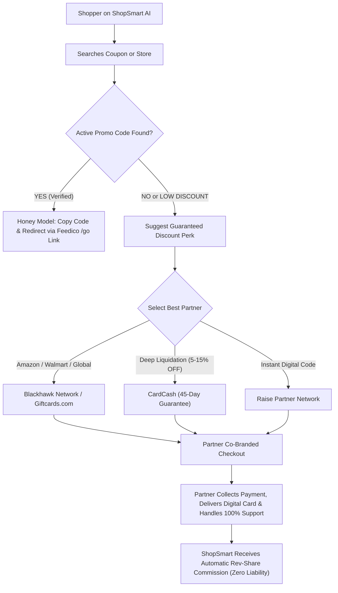

# ShopSmart AI — Master Partnership Strategy Blueprint & Future Approvals Roadmap
**File:** `STRATEGY_BLUEPRINT_PARTNERSHIP.md` (Project Root)  
**Status:** ACTIVE FUTURE APPROVALS LEDGER & SINGLE SOURCE OF TRUTH  
**Last Updated:** 2026-11-03  
**Architecture Principle:** 100% Zero-Liability, Zero-Headache, Hands-Off Fulfillment, No Minimum Commitment.

---

## 1. Executive Summary & Zero-Headache Mandate

ShopSmart AI enables instant, guaranteed savings for shoppers globally across multiple verticals. To scale efficiently without financial or legal overhead, all partner integrations in this blueprint strictly satisfy the **Zero-Headache & Zero-Liability Mandate**:

```
┌────────────────────────────────────────────────────────────────────────────────────────┐
│                        SHOPSMART ZERO-HEADACHE OPERATING RULE                          │
├───────────────────────────────────────┬────────────────────────────────────────────────┤
│ What ShopSmart AI Does (Smart Frontend)│ What Partner Platform Handles (100% Liability) │
├───────────────────────────────────────┼────────────────────────────────────────────────┤
│ • AI Comparison, Discovery & Search   │ • Payment Gateway & PCI-DSS Compliance         │
│ • Real-time Savings Calculation       │ • Fraud Detection, Carding Prevention & 3DS    │
│ • High-intent Co-branded Redirection  │ • Instant Digital Code Generation & Delivery   │
│ • Zero Inventory, Zero Code Holding   │ • Refunds, Chargebacks & Customer Support      │
│ • Passive Affiliate/Partner Rev-Share │ • Tax, GST/VAT & Country Regulatory Filings    │
└───────────────────────────────────────┴────────────────────────────────────────────────┘
```

---

## 2. Master Category & Partner Matrix for Future Approvals

| Category / Vertical | Primary Partner Platform | Network / Approval Channel | Approval Difficulty | Minimum Commitment | Model & ShopSmart Margin |
| :--- | :--- | :--- | :---: | :---: | :--- |
| **Coupons & Guaranteed Discount Cards #1** | **Blackhawk Network / Giftcards.com** | CJ Affiliate / Impact.com | 🟢 Instant / Fast | $0 (No minimum) | Co-branded deep link, 2%–8% discount, 1%–4% affiliate rev-share |
| **Coupons & Guaranteed Discount Cards #2** | **CardCash Partner Network** | CJ Affiliate (Publisher ID) | 🟢 Fast Track | $0 (No minimum) | Secondary discount pool (up to 15% off retail), 2%–5% rev-share |
| **Coupons & Guaranteed Discount Cards #3** | **Raise Partner Network** | Impact.com Marketplace | 🟢 Instant / Fast | $0 (No minimum) | Instant digital delivery, 2%–10% guaranteed savings, 1.5%–3% rev-share |
| **Retail & Hyperlocal Coupons** | **Feedico Managed Catalog** | `api.feedico.io` Direct Partner | 🟢 Fast (Domain verified) | $0 (No minimum) | Honey-style verified promo codes, 65% rev-share |
| **Flights & NDC Airfares** | **Duffel API** | `duffel.com` Self-Serve Developer | 🟢 Instant Developer Token | $0 (Pay per order) | Wholesale Net Fare API (0% Agent Markup / White-label) |
| **Hotels & Accommodations** | **Agoda B2B / Hotelbeds** | Agoda Partner Hub / Hotelbeds B2B | 🟡 Fast / Moderate | $0 (No deposit required) | Gated Wholesale Net Rates (Satisfies Hotel Rate Parity) |
| **Events, Concerts & Comedy** | **Ticket Evolution API** | Ticket Evolution B2B Network | 🟡 Moderate (Developer Application) | $0 (Wholesale access) | Headless ticket broker inventory, white-label seat picker |
| **Attractions & Theme Parks** | **Viator / Tiqets Partner API** | Tripadvisor Viator Partner API | 🟢 Fast Track | $0 (No minimum) | Instant digital barcode pass, 8%–10% rev-share |
| **Software, SaaS & Cloud** | **Secret B2B Partner Network** | `joinsecret.com` Partner Program | 🟢 Fast | $0 (No minimum) | $1,000+ credits for AWS, Notion, Stripe; 30% user savings |

---

## 3. Deep Dive: The 3 Coupon & Guaranteed Savings Platforms

### 3.1. Platform 1: Blackhawk Network / Giftcards.com
* **Corporate Profile**: Blackhawk Network is the world's largest prepaid & gift card issuer, partnering directly with Apple, Amazon, Walmart, Target, Google Play, Starbucks, and 1,000+ global brands.
* **Network & Approval**: Available via **CJ Affiliate (Commission Junction)** and **Impact.com**.
* **Why ShopSmart Chose It**:
  - **Zero Commitment**: Free publisher registration; no minimum monthly order commitments.
  - **Global & Multicurrency**: Supports US, UK, Canada, Australia, and European gift cards.
  - **Co-Branding**: Links carry ShopSmart referral tracking; user lands on official Giftcards.com checkout.
* **Liability & Fulfillment**:
  - Payment, credit card fraud verification, and digital barcode delivery via email are 100% handled by Blackhawk.
  - ShopSmart carries **zero inventory risk** and **zero customer support obligations**.
* **ShopSmart UI Integration**:
  - Under verified coupons for Amazon/Walmart/Target:
  - *"Don't have a working promo code? Get a Guaranteed 3% OFF Instant Digital Card via ShopSmart Perks."*
  - Interactive calculator displays: `$100 Cart Value → Pay $97 → Save $3 Instantly`.

### 3.2. Platform 2: CardCash Partner Program
* **Corporate Profile**: CardCash is the leading digital secondary gift card marketplace in North America, allowing verified peer-to-peer and bulk liquidation at steep discounts.
* **Network & Approval**: Direct Partner Program via **CJ Affiliate** and **CardCash API**.
* **Why ShopSmart Chose It**:
  - **Massive Discounts**: Up to 5%–15% off top retail brands (Home Depot, Best Buy, Sephora, Nike, Macy's, Uber).
  - **45-Day Buyer Protection**: CardCash guarantees every card balance for 45 days. If a card has an invalid balance, CardCash refunds the customer directly.
* **Liability & Fulfillment**:
  - CardCash validates card balances before sending to customer.
  - CardCash handles customer service, replacements, and payment disputes.
* **ShopSmart UI Integration**:
  - Dynamic "Guaranteed Discount" drawer when coupon success probability is below 50%.
  - User is routed directly to pre-filtered CardCash brand page with ShopSmart affiliate tag.

### 3.3. Platform 3: Raise Partner Network
* **Corporate Profile**: Raise (formerly Raise.com) is a premier mobile-first payments and discounted gift card engine with millions of active users.
* **Network & Approval**: Managed via **Impact.com** (Raise Marketplace Campaign).
* **Why ShopSmart Chose It**:
  - **Instant Digital Delivery**: Digital codes delivered within seconds in-app or via email.
  - **Global Tech Stack**: Clean deep-linking API that allows deep landing directly on the specific merchant's card denomination page (e.g., Target $50, Starbucks $25).
  - **High Conversion**: Instant checkout with Apple Pay, Google Pay, PayPal, and credit cards.
* **Liability & Fulfillment**:
  - Raise assumes 100% payment risk, chargebacks, and KYC verification.
  - Zero support tickets touch ShopSmart's servers.

---

## 4. Deep Dive: Travel, Flights, Hotels & Events Partners

### 4.1. Flights: Duffel API (Wholesale NDC Integration)
* **Approval URL**: `https://duffel.com` (Developer sign-up)
* **Model**: Direct NDC (New Distribution Capability) connection with 300+ global airlines (Emirates, Lufthansa, British Airways, United, American Airlines, IndiGo).
* **Zero Liability Feature**: Duffel acts as the tech aggregator while the airline or Duffel's accredited IATA license handles the ticket issuance.

### 4.2. Hotels: Agoda B2B / Hotelbeds
* **Approval Channel**: Agoda Partner Solutions & Hotelbeds Wholesale API.
* **Model**: Gated B2B wholesale rates hidden behind Clerk login to protect rate parity laws while delivering genuine 10%–25% off public Booking/Expedia rates.
* **Zero Liability Feature**: Agoda/Hotelbeds handles guest check-in guarantees, cancellations, and merchant billing.

### 4.3. Live Events & Concerts: Ticket Evolution
* **Approval Channel**: Ticket Evolution B2B Developer Network.
* **Model**: Direct white-label ticket broker feed with real-time seat mapping for Broadway, NFL, NBA, and global concert tours.
* **Zero Liability Feature**: 200% buyer guarantee handled by Ticket Evolution broker network.

### 4.4. Attractions & Tours: Viator (Tripadvisor Company)
* **Approval Channel**: Viator Partner Program via Travelpayouts / Direct API.
* **Model**: Instant digital barcode vouchers for Eiffel Tower, Burj Khalifa, Disneyland, Universal Studios.
* **Zero Liability Feature**: Viator handles tour guide coordination, cancellations, and refunds.

### 4.5. SaaS & Software: Secret B2B Partner Network
* **Approval Channel**: `joinsecret.com` affiliate & API partner program.
* **Model**: Gated perks offering up to $1,000+ cloud credits and 20%–50% discounts on tools like AWS, Notion, Airtable, HubSpot, Loom.
* **Zero Liability Feature**: Secret verifies user eligibility and issues merchant coupons directly.

---

## 5. Step-by-Step Approval Checklist (When Ready to Apply)

```
[ ] Step 1: Create Master Publisher Account on Impact.com
    └── Apply to: Raise Partner Network & Blackhawk Network / Giftcards.com
    └── Required Details: ShopSmart domain, traffic focus (Global Coupons & AI Shopping)

[ ] Step 2: Create Master Publisher Account on CJ Affiliate (Commission Junction)
    └── Apply to: CardCash & Giftcards.com CJ Campaign
    └── Category: Shopping / Price Comparison & Coupons

[ ] Step 3: Complete Feedico Domain Verification (`feedico.io`)
    └── Retrieve `fdco_` production Bearer token for live coupon retrieval.

[ ] Step 4: Register Duffel Developer Account (`duffel.com`)
    └── Generate test API keys and verify NDC airfare schema.

[ ] Step 5: Activate Clerk Gate for Rate Parity
    └── Verify authenticated token requirement before unlocking wholesale rates.
```

---

## 6. Zero-Liability Redirection Architecture (Flowchart)



---
**END OF BLUEPRINT — PERMANENT RECORD IN REPOSITORY**
