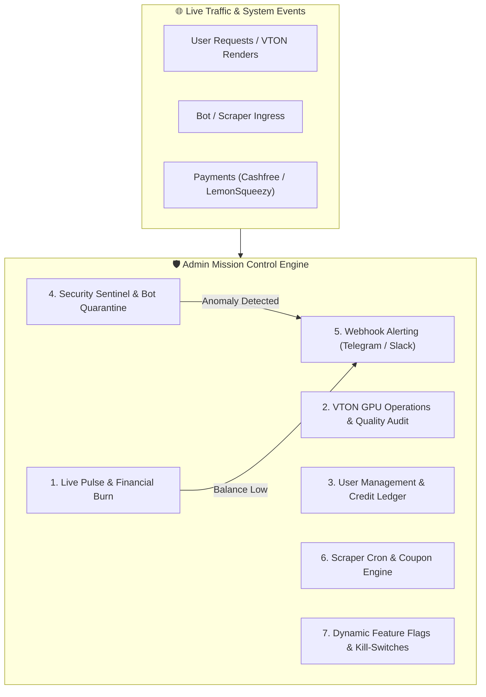
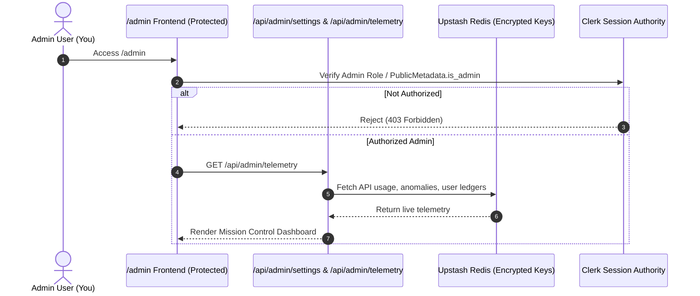

# 🛡️ Enterprise AI Command Center & Admin Mission Control
### ShopSmart AI / Zippy: Complete Platform Governance & Monitoring Architecture

---

## 1. Executive Vision: Why a Standard CRUD Admin is Obsolete

A modern AI Shopping Assistant is not just an e-commerce website; it is an **orchestration of distributed neural networks, GPU clusters, search scrapers, and financial credit ledgers**. 

A single undetected malicious actor could:
1. Burn ₹20,000 in GPU compute (PixelAPI / VTON) in 2 hours via multi-account bot farms.
2. Exhaust monthly ScraperAPI / Groq quotas with automated search spam.
3. Cause silent degradation if an upstream API changes its DOM structure or returns errors.

Therefore, our Admin Panel is designed as a **Real-Time Mission Control (कमांड सेंटर)** centered on **Security, Cost Transparency, User Governance, and Instant Alerting**.

---

## 2. The 7 Pillars of the Command Center

### Pillar 1: 📊 Executive Live Pulse & API Burn Dashboard (वित्तीय नियंत्रण)
*Tracks every single rupee spent on cloud AI vs revenue earned in real time:*
* **Gross Daily Revenue**: Real-time sales from ₹10 / ₹40 VTON sachets + ₹149 / ₹199 monthly combo passes.
* **API Cost Burn Meter**:
  * **PixelAPI (GPU VTON)**: Cost today (e.g. 18 renders @ ₹2.5 = ₹45.00).
  * **Groq LLM (Shopping Concierge)**: Tokens consumed & micro-cost (e.g. ₹0.35).
  * **ScraperAPI / SerpAPI**: Credits consumed today vs monthly allowance.
* **Live Net Margin Gauge**: e.g., `Revenue: ₹840` | `API Burn: ₹125` | `Net Profit: ₹715 (85.1% Margin)`.

---

### Pillar 2: 👗 VTON GPU Operations & Visual Audit Gallery
*Monitors the heavy GPU diffusion pipeline to prevent silent failures:*
* **Cluster Concurrency Meter**:
  * Active rendering jobs (e.g., `2 / 5 Global Slots In-Use`).
  * Average render latency (e.g., `2.1s average`).
* **Auto-Refund Watchdog**:
  * If a user's uploaded photo has no person or PixelAPI times out, the system auto-refunds the user's credit and logs the incident here.
* **Safety & Quality Audit (Anonymized Gallery)**:
  * Admin thumbnail view of recent renders to verify fit quality and flag non-clothing/NSFW abuse.

---

### Pillar 3: 👥 User Governance & Credit Ledger (Clerk + Upstash Redis)
*Complete control over user accounts and customer support:*
* **Live User Directory**:
  * Search by Name, Email, or Clerk User ID.
  * Shows: Total Searches Done, VTON Credits Remaining, Current Plan (Free / Smart Pass / VIP Pro).
* **1-Click Customer Support Actions**:
  * `[+5 Free VTON Credits]` (Instantly rewards a user if they had a bad try-on).
  * `[Reset Daily Search Quota]`.
  * `[Upgrade to VIP Pro for 30 Days]`.
  * `[Quarantine / Ban User]` (Instantly revokes Clerk session and blacklists IP).

---

### Pillar 4: 🛡️ Security Sentinel & Anomaly Detection (मलेशियस एक्टिविटी शील्ड)
*Catches attacks before they cost money:*
* **Sybil Multi-Account Detector**:
  * Flags when more than 3 accounts are created from the exact same IP/fingerprint within 1 hour (attempting to milk the 2 free welcome try-ons).
* **Rapid-Fire Rate Limit Triggers**:
  * Displays IPs that hit the 30-request threshold or made 5+ requests in under 10 seconds.
* **1-Click Defense Actions**:
  * **"Emergency Auth Lockdown"**: Forces all users (even casual searchers) to sign in with Google/Apple before performing queries.
  * **"Global IP Blacklist"**: Immediately drops all requests from a suspicious subnet.

---

### Pillar 5: 🔔 Instant Alert Dispatcher (Webhook Notifications)
*You don't need to stare at the admin panel 24/7; the system notifies you immediately when something needs attention:*
* **Supported Channels**: Telegram Bot, Discord Webhook, or WhatsApp Cloud API.
* **Critical Triggers**:
  1. 🚨 **API Balance Warning**: When PixelAPI, Groq, or ScraperAPI credits drop below 15%.
  2. 🚨 **Security Attack**: When an IP triggers 20+ rate limit errors in 60 seconds.
  3. 🚨 **Infrastructure Outage**: If Upstash Redis or Clerk returns a 5xx error.
  4. 🎉 **Financial Notification**: Every time a user purchases a ₹40 or ₹149 pass.

---

### Pillar 6: 🏷️ Coupon Scraper & Cache Ingestion Manager
*Maintains fresh promo codes without manual data entry:*
* **ScraperAPI Health**: Live balance check (e.g. `4,120 / 5,000 monthly credits available`).
* **Cron Job Status**: Last run timestamp, stores crawled (Amazon, Flipkart, Myntra, Swiggy, Zomato).
* **Manual "Run Sync Now" Button**: Forces an instant refresh of live deals before a major sale (e.g. Big Billion Days / Great Indian Festival).
* **Featured Deals Pinning**: Manually pin high-commission exclusive deals to the top of the Deals Explorer.

---

### Pillar 7: 🎛️ Dynamic Platform Kill-Switches (Zero-Downtime Control)
*Toggle features instantly from the UI without code changes or redeployments:*

| Feature Switch | Description | Default |
| :--- | :--- | :--- |
| `VTON Studio Active` | Temporarily pause Try-Ons if GPU provider has maintenance. | **ON** |
| `Strict Sign-In for Search` | Require Google/Apple sign-in for all searches (anti-scraping). | **OFF** |
| `In-App Shopping Chat` | Enable/disable the conversational AI screen advisor. | **ON** |
| `Maintenance Banner` | Displays a global status banner at the top of the homepage. | **OFF** |

---

## 3. Data Flow & Security Architecture

