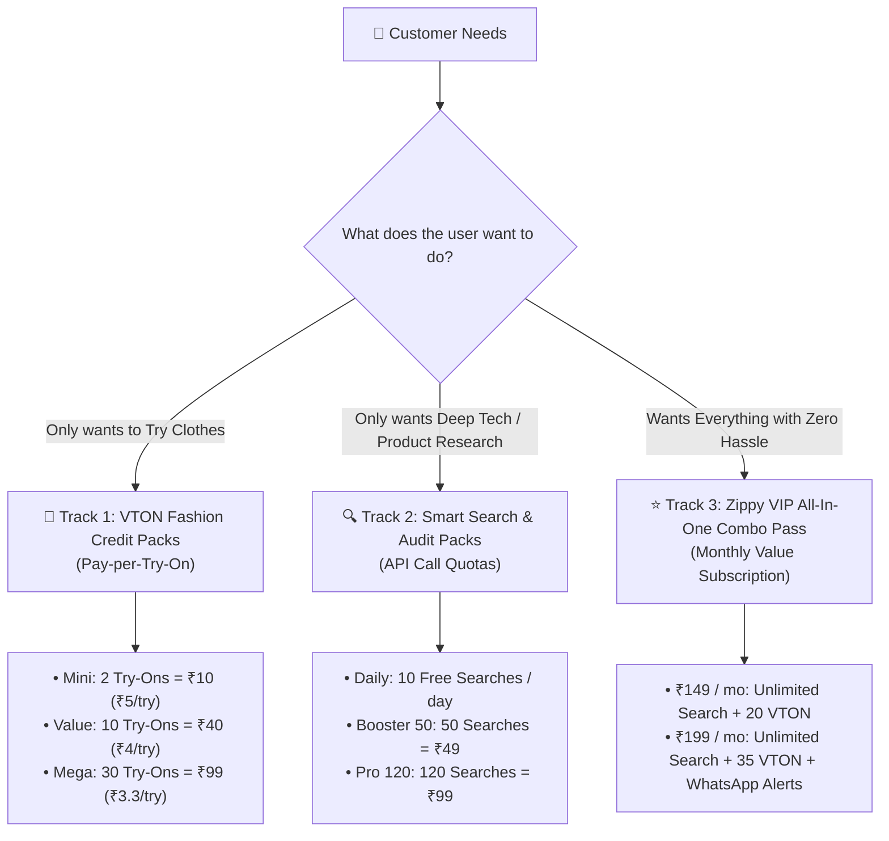
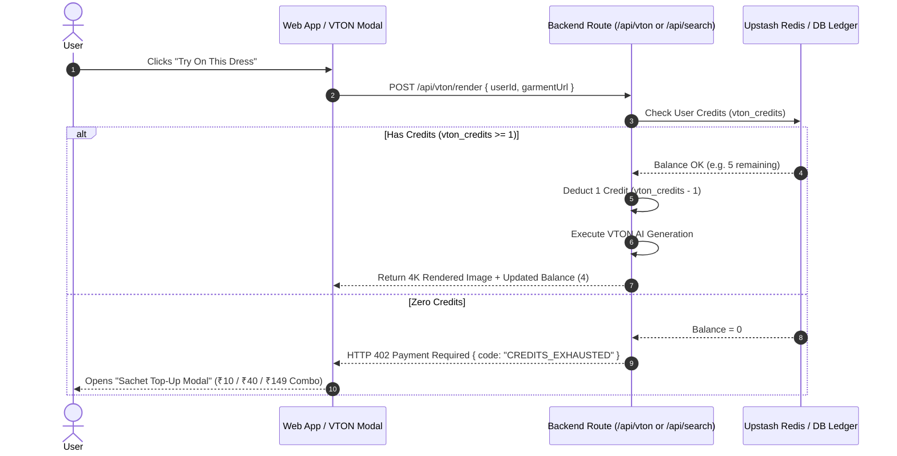

# 💎 Modular Credit & Subscription Architecture
### AI Shopping Assistant: Unit Economics & Sachet Pricing Engine

---

## 1. Unit Economics & Cost Breakdown (Backend Reality)

To guarantee profitability from Day 1, our pricing must maintain a **50% to 80% gross profit margin** on every single API call:

| Feature / Action | Backend Infrastructure Cost | User Price (Sachet / Bulk) | Gross Profit Margin |
| :--- | :--- | :--- | :--- |
| **1 Virtual Try-On (VTON)** | **₹2.00 – ₹2.50** (GPU Compute / AI Model) | **₹4.00 – ₹5.00** | **50% – 60% Margin** |
| **1 Smart AI Search / Audit** | **₹0.15 – ₹0.30** (Groq LLM + Search Scraper) | **₹0.80 – ₹1.00** | **70% – 85% Margin** |
| **1 Cart Screenshot OCR Audit** | **₹0.50 – ₹0.80** (Vision Model OCR + Coupons) | **₹2.00 – ₹3.00** | **70% – 75% Margin** |

---

## 2. The 3-Track Modular Pricing Architecture

Instead of forcing a single rigid monthly plan, we provide **unbundled flexibility** (Indian "Sachet Pricing" model) alongside a comprehensive **All-In-One Combo Pass**:

---

## 3. Plan Specifications & Packaging

### Track 1: 👗 VTON Try-On Credit Packs (Pay-As-You-Go)
*No recurring commitment. Perfect for shoppers buying clothes on Myntra, Ajio, or Amazon right now.*

| Pack Name | Credits | Price | Per Try-On Cost | Margin | Best For |
| :--- | :--- | :--- | :--- | :--- | :--- |
| **Free Trial** | 2 Credits | **₹0** | Free Hook | Marketing Cost | New user onboarding |
| **Mini Try-On Pack** | 2 Credits | **₹10** | ₹5.00 / try | 50% | Impulse buyers (1 outfit test) |
| **Value Fashion Pack** | 10 Credits | **₹40** | ₹4.00 / try | 55% | Weekend shopping spree |
| **Stylist Mega Pack** | 30 Credits | **₹99** | ₹3.30 / try | 45% | Wardrobe makeover & wedding prep |

*Note: VTON credits never expire and roll over indefinitely.*

---

### Track 2: 🔍 Smart Search & Concierge Packs (API Call Quotas)
*For buyers researching laptops, smartphones, home appliances, or checking drug salts.*

| Pack Name | Search Quota | Price | Features Included |
| :--- | :--- | :--- | :--- |
| **Daily Free Quota** | 10 Searches / day | **₹0** | Resets every midnight. Keeps casual users engaged. |
| **Search Booster 50** | 50 Smart Searches | **₹49** | Deep specs audit, price comparison, brand neutrality. |
| **Power Shopper 120** | 120 Smart Searches | **₹99** | Full terminal audit, coupon scraping, review analysis. |

---

### Track 3: ⭐ "Zippy VIP" All-In-One Combo Passes (Monthly SaaS)
*For regular shoppers who want high convenience and continuous price protection.*

#### Option A: "Zippy Smart Pass" — ₹149 / month ($2.99 Global)
* **Unlimited** Smart AI Searches & Concierge Queries (Zero daily caps).
* **20 High-Res VTON Try-On Credits** per month (Cost to us: ~₹45; Net Profit: **₹104**).
* **Cart Screenshot Discount Auditor** (Unlimited scans).
* **WhatsApp Price Drop Alerts** on up to 5 tracked items.

#### Option B: "Zippy VIP Pro" — ₹199 / month ($3.99 Global)
* **Unlimited** Smart AI Searches & Concierge Queries.
* **35 4K VTON Try-On Credits** per month (Cost to us: ~₹75; Net Profit: **₹124**).
* **VIP Priority GPU Queue** (Instant 2-second VTON rendering).
* **Personalized AI Stylist** (Color season, skin tone, occasion matching).
* **Supplement Lab-Report Verification** (Protein % & heavy metal audits).
* **WhatsApp Price Drop Alerts** on up to 15 tracked items.

---

## 4. User Credit Ledger Architecture (`src/services/creditManager.js`)

---

## 5. Day-1 Checkout Flow (UPI Instant QR / Cashfree / LemonSqueezy)

1. **For Indian Users (UPI Sachet Frictionless)**:
   - User clicks **"₹10 (2 Try-Ons)"** or **"₹49 (50 Searches)"**.
   - Instant dynamic UPI QR Code appears (Google Pay, PhonePe, Paytm).
   - User scans with mobile -> Webhook receives payment in 1 second -> Credits added instantly without page reload!
2. **For Global / US Users**:
   - LemonSqueezy checkout overlay: Card, Apple Pay, Google Pay ($0.99 for Mini, $2.99 for Combo).
