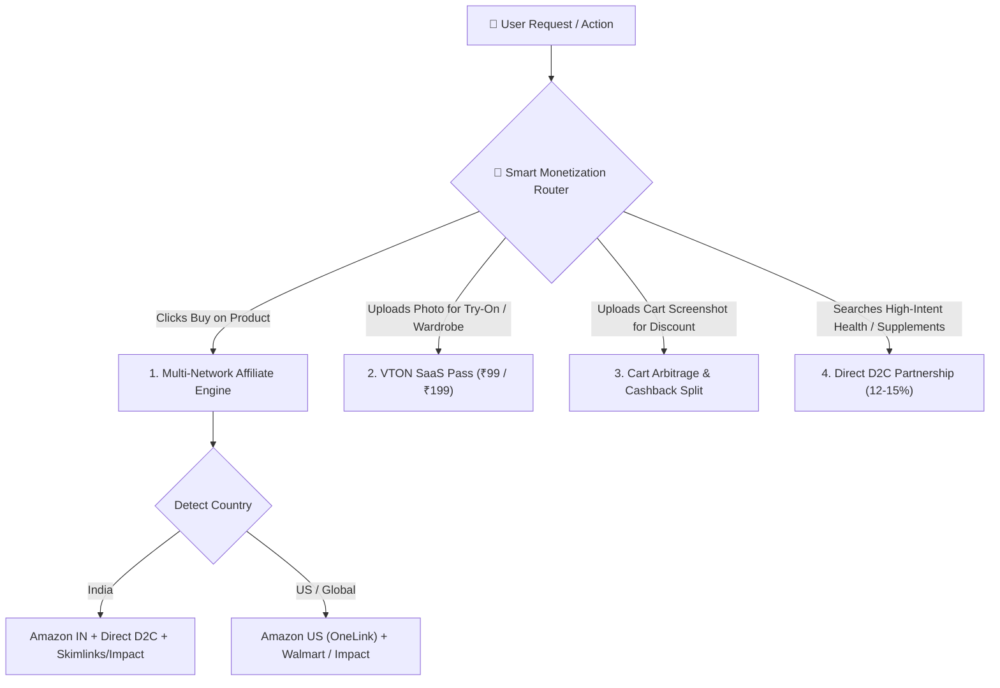
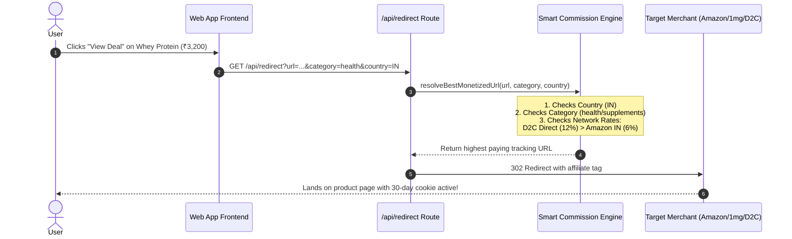
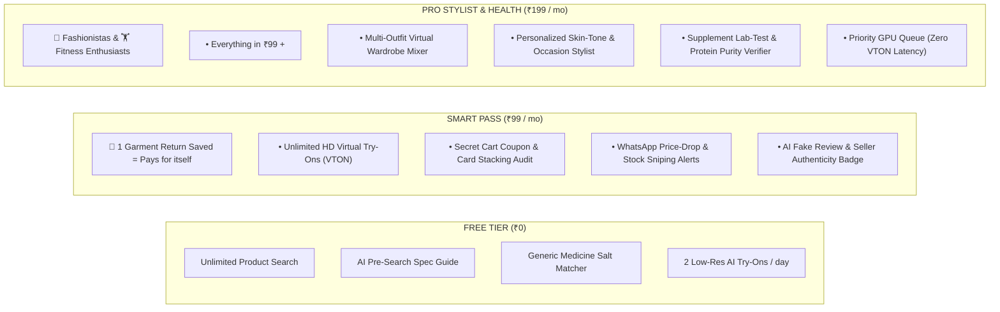

# 🚀 Day-1 Monetization & Revenue Architecture
### AI Shopping Assistant: Global & India-Ready Monetization Engine

---

## 1. Executive Summary & Revenue Formula

An AI Shopping Assistant cannot rely on a single monetization stream or a single affiliate network. Conversion rates on affiliate clicks vary between **1.5% to 4%**, meaning that relying strictly on low-margin categories (like smartphones at 1-2%) will starve the business of cash flow.

The winning formula is a **Hybrid Revenue Stack**:
$$\text{Total Revenue} = \text{Smart Affiliate Routing (CPS)} + \text{High-Margin Category Arbitrage} + \text{SaaS Subscriptions (VTON/Alerts)} + \text{Direct D2C Brand Bidding}$$

---

## 2. The Day-1 Affiliate Approval Blueprint (Zero Waiting / Zero Traffic Proof)

Traditional Indian sub-networks (like Cuelinks, vCommission) frequently reject or stall new websites because they require verified monthly traffic stats, Alexa rank, or business entity documents.

Here are the networks and direct programs that **grant approval on Day 1**:

### A. Global & US Traffic (Day 1 Approval)
1. **Amazon Associates (India + US via OneLink)**:
   - **Approval Speed**: **Instant (Day 1)**.
   - **Requirement**: No company registration needed. Individual PAN (India) or SSN/W-8BEN (US).
   - **How it works**: You get your Associate Store Tag immediately (`myshopin-21` for India, `myshopus-20` for US).
   - **OneLink Feature**: Amazon automatically redirects a US user clicking an Indian link to the equivalent Amazon.com US product and credits your US affiliate account!
   - **Rule to know**: You need 3 sales within the first 180 days (easily achieved with early beta testers/family).

2. **Impact.com (Developer & Tech Publisher Program)**:
   - **Approval Speed**: Day 1 for publisher account; instant programmatic access to tech and D2C brands (Walmart, Target, Lenovo, Myntra, Tata CLiQ).
   - Clean REST API for automated link tracking and SubID injection.

3. **Sovrn // Commerce (formerly VigLink) / Skimlinks**:
   - Automated monetization: You pass a clean merchant URL, their API returns a monetized tracking link across 50,000+ global merchants (US & India).

### B. India-Specific High-Margin Direct D2C Programs (Day 1 Auto-Approval)
India's top health, supplement, and fashion brands do **NOT** rely on Cuelinks; they run their own affiliate portals on **Shopify / GoAffPro / UpPromote**:
* **Health & Supplements (8% – 15% commission)**:
  - MuscleBlaze / HealthKart Affiliate Portal (Direct signup, instant tracking links).
  - Fast&Up / The Whole Truth / Kapiva (Instant affiliate portals for content/app creators).
* **Pharmacy (5% – 10% commission)**:
  - Tata 1mg & Apollo 24|7 (via Impact.com or direct digital health partnerships).

---

## 3. Dynamic Multi-Network Commission-Maximizing Architecture

### The Problem:
- Amazon pays **1.5%** on smartphones and **2.5%** on laptops.
- But Tata CLiQ or Croma might pay **3.5%** on electronics.
- Direct supplement brands pay **12% - 15%**, while Amazon pays only **5% - 8%** on whey protein.
- **Verdict**: Depending on ONE network guarantees you leave 50%+ of your revenue on the table.

### The Solution: Smart Commission Routing Engine (`src/services/affiliateRouter.js`)

### Commission Matrix by Category:

| Category | Typical Ticket Size | Commission % | Expected Earning / Sale | Best Network / Route |
| :--- | :--- | :--- | :--- | :--- |
| **Electronics & Phones** | ₹15,000 – ₹70,000 | 1.0% – 2.5% | ₹200 – ₹1,200 | Amazon IN / Tata CLiQ / Croma (High volume, high trust) |
| **Fashion & Apparel** | ₹1,200 – ₹4,500 | 7.0% – 12.0% | ₹120 – ₹450 | Myntra / Ajio (via Impact.com) / Amazon Fashion |
| **Pharmacy & Medicine** | ₹400 – ₹1,800 | 6.0% – 10.0% | ₹35 – ₹180 | Tata 1mg / Apollo 24|7 / Pharmeasy |
| **Fitness & Supplements** | ₹2,000 – ₹6,500 | 8.0% – 15.0% | ₹200 – ₹850 | Direct HealthKart / MuscleBlaze Portal / Fast&Up |
| **Grocery / Quick Commerce**| ₹300 – ₹1,200 | Flat ₹25 – ₹45 | ₹25 – ₹45 / order | Blinkit / Zepto / Swiggy Instamart |

---

## 4. SaaS Subscription Architecture: ₹99 vs ₹199 Pricing Strategy

Users will **never** pay a subscription just to search for products. They will gladly pay for **direct financial savings, high-compute AI features, and shopping speed**.

### The Psychology of Pricing:
* **₹99/month ($1.99/mo for US)**: An **impulse decision**. A single saved shipping fee, one unlocked ₹150 promo code, or one avoided return on ill-fitting clothing covers the entire monthly cost.
* **₹199/month ($3.99/mo for US)**: Targetted at power buyers who buy supplements monthly or order fashion weekly.

---

## 5. Day-1 Payment Gateway Providers (Instant Approval)

| Gateway | Market Covered | Approval Speed | Verification Requirements | Subscription / Recurring Support |
| :--- | :--- | :--- | :--- | :--- |
| **Cashfree Payments** | 🇮🇳 India | **1–2 Days** (Instant Sandbox) | Individual PAN + Aadhaar + Bank Account (No Pvt Ltd required) | Excellent (UPI AutoPay, Cards, NetBanking) |
| **Razorpay** | 🇮🇳 India | **2–3 Days** | Individual / Sole Proprietor KYC | Industry standard for India (Cards, UPI, Subscriptions) |
| **LemonSqueezy** *(Recommended for Global)* | 🌍 Global + US + India | **Day 1 (Instant)** | Acts as **Merchant of Record (MoR)**. Individual signups approved instantly. | Handles global tax, currency conversion, Stripe backend, webhooks |
| **Dodo Payments / Paddle** | 🌍 Global + India | **Day 1–2** | Built for AI SaaS products. Instant checkout links. | Automatic recurring billing in USD and INR |

---

## 6. Implementation Action Plan

1. **Step 1: Universal Affiliate Link Transformer**:
   - Update `src/app/api/redirect/route.js` with an extensible provider registry (`amazon_in`, `amazon_us`, `impact`, `direct_d2c`).
2. **Step 2: SubID Tracking**:
   - Attach anonymous session tracking tags (`subid=zippy_vton_outfit_123`) to measure exactly which AI feature produces the highest earnings.
3. **Step 3: Freemium VTON Metering**:
   - Implement cookie/IP based free usage counter (2 free try-ons) with a modern "Unlock Zippy Smart Pass for ₹99" modal trigger.
